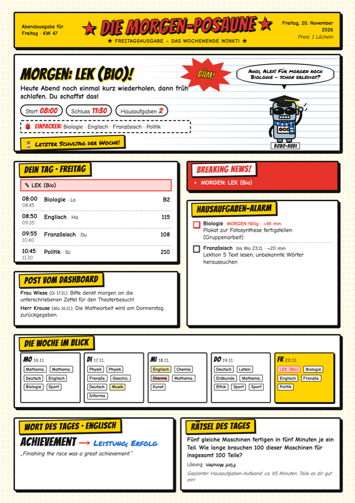
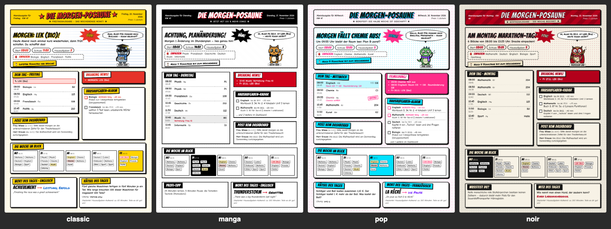

# Die Morgen-Posaune 📰

**Eine Comic-Zeitung für den nächsten Schultag – automatisch aus dem Schul-Dashboard, fertig zum Ausdrucken (A4).**

Nach der Schule ein Befehl, und auf dem Drucker liegt eine bunte Zeitung mit Stundenplan, Ausfällen,
Raumänderungen, Tests, Hausaufgaben, Nachrichten, Packliste für die Schultasche – plus Witz, Rätsel,
Fakt oder Vokabel des Tages. Jeden Tag in einem anderen Look.



> Gebaut für Schul-Dashboards auf Basis von [specht/schul-dashboard](https://github.com/specht/schul-dashboard)
> (z. B. `dashboard.gymnasiumsteglitz.de`). Inoffizielles Hobbyprojekt – nicht mit der Schule oder dem
> Dashboard-Projekt verbunden. Bitte nur mit dem **eigenen** Zugang bzw. dem Zugang des eigenen Kindes benutzen.

---

## Inhalt

- [Funktionen](#funktionen)
- [Voraussetzungen](#voraussetzungen)
- [Installation](#installation)
- [Einrichtung](#einrichtung)
- [Benutzung](#benutzung)
- [Drucken](#drucken)
- [Stile und tägliche Abwechslung](#stile-und-tägliche-abwechslung)
- [KI-Inhalte mit OpenAI (optional)](#ki-inhalte-mit-openai-optional)
- [Automatisch starten (optional)](#automatisch-starten-optional)
- [So funktioniert es](#so-funktioniert-es)
- [Datenschutz und Sicherheit](#datenschutz-und-sicherheit)
- [Erweitern](#erweitern)
- [Fehlerbehebung](#fehlerbehebung)
- [Lizenz](#lizenz)

---

## Funktionen

- **Automatischer Login** ins Dashboard: E-Mail-Adresse eintragen, den Anmeldecode liest das Programm
  selbst aus dem Postfach (IMAP). Danach bleibt die Sitzung ein Jahr gültig.
- **Abendausgabe für den nächsten Schultag** (freitags und am Wochenende: für Montag) – Hausaufgaben
  lassen sich dann noch erledigen und die Tasche packen. Eine Morgenausgabe ist ebenfalls möglich.
- **Was drinsteht:**
  - Stundenplan des Tages mit Ausfällen, Vertretungen, Raumänderungen und Stundenthemen
  - Ganztägige Termine (z. B. Studientag) und Tests (LEK) – auch als Vorwarnung für die nächsten Tage
  - Hausaufgaben, auch die in den letzten Stunden aufgegebenen (fällig in der nächsten Stunde des Fachs)
  - Nachrichten aus dem Dashboard
  - 🎒 Packliste (Fächer + Sportzeug)
  - Wochenübersicht, Countdown bis zum Wochenende bzw. Heiligabend
  - Witz, Rätsel (Lösung kopfüber), „Wusstest du?“, Wort des Tages (passend zu den eigenen
    Fremdsprachen: Englisch, Französisch, Latein, Spanisch) oder Profi-Tipp
- **Jeden Tag anders:** 4 Comic-Stile, 4 Kopfzeilen, 4 Hintergründe, 4 Maskottchen mit
  Accessoires (Doktorhut am Testtag, Weihnachtsmütze im Dezember, Schal im Winter, Sonnenbrille am Freitag).
- **Mehrere Kinder:** ein Profil pro Kind, ein Befehl für alle.
- **Optional:** frische Witze, Rätsel, Fakten und Vokabeln von OpenAI – mit Rückfall auf die eingebauten
  Listen, wenn die API nicht erreichbar ist.
- **Druck** direkt auf den Standarddrucker (CUPS/`lp`).



---

## Voraussetzungen

- **macOS oder Linux** (zum Drucken wird CUPS mit dem Befehl `lp` benutzt; unter macOS vorhanden)
- **Python 3.12 oder neuer**
- **[uv](https://docs.astral.sh/uv/)** (Paketmanager für Python)
- Ein **E-Mail-Postfach mit IMAP-Zugang**, in dem die Anmeldecodes des Dashboards ankommen
  (z. B. das Schul-Postfach bei IONOS)
- Optional ein **Drucker** und ein **OpenAI-API-Key**

`uv` installieren (falls noch nicht vorhanden):

```bash
curl -LsSf https://astral.sh/uv/install.sh | sh
```

---

## Installation

```bash
git clone https://github.com/Juergen-J/steglitz-dashboard-zeitung.git
cd steglitz-dashboard-zeitung
uv sync
uv run playwright install chromium
```

`uv sync` legt eine virtuelle Umgebung an und installiert alle Abhängigkeiten.
`playwright install chromium` lädt einen Browser (ca. 100 MB), mit dem das PDF erzeugt wird.

Kurzer Test ohne Login – erzeugt eine Zeitung mit Beispieldaten:

```bash
uv run zeitung --demo --open
```

---

## Einrichtung

Die Einstellungen liegen in zwei Arten von Dateien:

| Datei | Inhalt |
|---|---|
| `.env` | Gemeinsame Einstellungen: Dashboard-Adresse, Mailserver, Drucker, Stil, OpenAI |
| `profiles/<name>.env` | Pro Kind: E-Mail-Adresse, Postfach-Passwort, Name, ausgeblendete Fächer |

### 1. Gemeinsame Einstellungen

```bash
cp .env.example .env
```

Danach `.env` öffnen und anpassen. Die wichtigsten Werte:

| Variable | Bedeutung | Standard |
|---|---|---|
| `DASHBOARD_URL` | Adresse des Dashboards | `https://dashboard.gymnasiumsteglitz.de` |
| `IMAP_HOST`, `IMAP_PORT` | Mailserver für die Anmeldecodes | `imap.ionos.de`, `993` |
| `NEWSPAPER_TITLE` | Name der Zeitung | `Die Morgen-Posaune` |
| `EDITION` | `abend` (für den nächsten Schultag) oder `morgen` (für heute) | `abend` |
| `COMIC_STYLE` | `classic`, `manga`, `noir`, `pop` oder `auto` (täglich wechselnd) | `auto` |
| `COMIC_STYLES` | Bei `auto`: nur aus diesen Stilen wählen, z. B. `classic,pop` | alle |
| `MASCOT` | `auto`, `owl`, `robot`, `cat`, `dino` | `auto` |
| `VARIETY` | Tägliche Abwechslung an/aus | `true` |
| `PRINTER` | Druckername (leer = Standarddrucker, siehe `lpstat -d`) | leer |
| `PRINT_COLOR` | Farbdruck (`false` = Graustufen) | `true` |
| `EVENT_EXCLUDE` | Termine ausblenden (Regex), z. B. Lehrerkonferenzen | sinnvolle Liste |
| `OPENAI_API_KEY` | Für KI-Inhalte (optional) | leer |

### 2. Ein Profil pro Kind

```bash
cp profiles/beispiel.env.example profiles/anna.env
```

`profiles/anna.env` ausfüllen:

```ini
DASHBOARD_EMAIL=anna.muster@mail.gymnasiumsteglitz.de
STUDENT_NAME=Anna
IMAP_USER=                 # leer = gleich DASHBOARD_EMAIL
IMAP_PASSWORD=dein-postfach-passwort
HIDE_SUBJECTS=Evangelische Religionslehre   # Fächer, die das Kind nicht hat
# optional: eigener Stil / Titel / Drucker
# COMIC_STYLE=manga
```

Der Dateiname (`anna`) ist der Profilname. Für jedes weitere Kind einfach eine weitere Datei anlegen.

> **Hinweis:** Persönliche Werte (E-Mail, Passwort, Name, ausgeblendete Fächer) werden **nie** aus der
> gemeinsamen `.env` in ein Profil übernommen – so landet nichts beim falschen Kind.
> Ohne Profile funktioniert das Programm auch nur mit `.env` (dann dort `DASHBOARD_EMAIL` usw. eintragen).

### 3. Erster Login

```bash
uv run zeitung -s anna --login-only
```

Das Programm fordert einen Code an, wartet auf die E-Mail (bis zu 3 Minuten), liest den Code aus und
meldet sich an. Die Sitzung wird in `data/sessions/` gespeichert und gilt ein Jahr.

---

## Benutzung

```bash
uv run zeitung                    # Zeitung für alle Profile erstellen
uv run zeitung --print            # erstellen und drucken
uv run zeitung --open             # erstellen und PDF öffnen
uv run zeitung -s anna            # nur für ein Profil (-s mehrfach möglich)
uv run zeitung --list             # Profile anzeigen
uv run zeitung --date 2026-11-23  # für einen bestimmten Schultag
uv run zeitung --style noir       # Stil für diesen Lauf festlegen
uv run zeitung --demo             # Beispieldaten statt Dashboard
uv run zeitung --no-ai            # ohne OpenAI, nur eingebaute Listen
uv run zeitung --help             # alle Optionen
```

Die PDFs landen in `out/<profil>/zeitung-<datum>-<stil>.pdf` (daneben eine HTML- und PNG-Version).

**Welcher Tag?** In der Abendausgabe (Standard) erscheint die Zeitung für den nächsten Schultag;
freitags und am Wochenende für Montag. Läufe zwischen Mitternacht und 4 Uhr zählen noch zum Vorabend.

---

## Drucken

```bash
uv run zeitung --print
```

Gedruckt wird mit `lp` auf A4, Seite eingepasst. Ohne Angabe nimmt das Programm den Standarddrucker.
Verfügbare Drucker anzeigen:

```bash
lpstat -p -d
```

Den Namen bei Bedarf als `PRINTER=…` in `.env` (oder im Profil) eintragen. Jede Zeitung wird als
eigenes Blatt gedruckt.

---

## Stile und tägliche Abwechslung

Die Variante eines Tages hängt von **Datum und Profil** ab: Ein erneuter Lauf am selben Tag ergibt
dieselbe Zeitung, Geschwister bekommen am selben Tag unterschiedliche Varianten.

| Was | Varianten |
|---|---|
| Stil | `classic`, `manga`, `noir`, `pop` (bei `COMIC_STYLE=auto` reihum) |
| Maskottchen | Professor Uhu, Robo-Rudi, Kater Karl, Dino Dora |
| Accessoires | 🎓 Testtag · 🎅 1.–26. Dezember · 🧣 November–Februar · 😎 Freitag und unterrichtsfreie Tage |
| Kopfzeile | 4 Designs + Slogan des Tages (Montag, Mittwoch, Freitag mit eigenem Spruch) |
| Aufmacher-Hintergrund | Strahlen, Rasterpunkte, Speedlines, Streifen |
| Kästen unten | 2 von: Witz, Rätsel, Wort des Tages, Wusstest du?, Profi-Tipp |

Alles abschalten: `VARIETY=false`.

---

## KI-Inhalte mit OpenAI (optional)

Mit einem `OPENAI_API_KEY` in `.env` holt das Programm **einmal pro Tag** (für alle Profile gemeinsam)
neue Witze, Rätsel, Fakten, Tipps, Slogans und Vokabeln über die
[Responses API](https://platform.openai.com/docs/api-reference/responses) mit strukturierter Ausgabe.

- **Qualität:** Das Modell bewertet Witze und Rätsel selbst und prüft Rätsel-Lösungen; nur Einträge mit
  mindestens 7/10 Punkten und passender Länge kommen in die Zeitung.
- **Modelle:** `OPENAI_MODEL=gpt-6-astra,gpt-5.4-mini` – geht das erste nicht, wird das nächste probiert.
- **Cache:** Die Antwort wird in `data/ai/<datum>.json` gespeichert; weitere Läufe am selben Tag fragen
  nicht erneut.
- **Wachsender Vorrat:** Neue Einträge (ohne Dubletten) wandern zusätzlich in `data/content_ai.json` und
  ergänzen die eingebauten Listen dauerhaft.
- **Rückfall:** Kein Key, kein Internet oder ein Fehler → die Zeitung nimmt Inhalte aus den Listen
  (`src/morgenzeitung/content.py` + bisheriger KI-Vorrat).
- **Kosten:** ein Aufruf pro Tag, typischerweise wenige Cent.
- Abschalten: `AI_CONTENT=false` oder einmalig `--no-ai`.

An OpenAI werden **keine** persönlichen Daten geschickt – nur Datum, Wochentag und die Liste bereits
vorhandener Witze/Wörter (gegen Wiederholungen).

---

## Automatisch starten (optional)

Beispiel für **macOS (launchd)**: Montag bis Freitag um 16:00 Uhr erstellen und drucken.
Datei `~/Library/LaunchAgents/de.morgenzeitung.plist` anlegen (Pfade anpassen):

```xml
<?xml version="1.0" encoding="UTF-8"?>
<!DOCTYPE plist PUBLIC "-//Apple//DTD PLIST 1.0//EN" "http://www.apple.com/DTDs/PropertyList-1.0.dtd">
<plist version="1.0">
<dict>
  <key>Label</key><string>de.morgenzeitung</string>
  <key>WorkingDirectory</key><string>/Users/DEIN-NAME/steglitz-dashboard-zeitung</string>
  <key>ProgramArguments</key>
  <array>
    <string>/Users/DEIN-NAME/.local/bin/uv</string>
    <string>run</string><string>zeitung</string><string>--print</string>
  </array>
  <key>StartCalendarInterval</key>
  <array>
    <dict><key>Weekday</key><integer>1</integer><key>Hour</key><integer>16</integer><key>Minute</key><integer>0</integer></dict>
    <dict><key>Weekday</key><integer>2</integer><key>Hour</key><integer>16</integer><key>Minute</key><integer>0</integer></dict>
    <dict><key>Weekday</key><integer>3</integer><key>Hour</key><integer>16</integer><key>Minute</key><integer>0</integer></dict>
    <dict><key>Weekday</key><integer>4</integer><key>Hour</key><integer>16</integer><key>Minute</key><integer>0</integer></dict>
    <dict><key>Weekday</key><integer>5</integer><key>Hour</key><integer>16</integer><key>Minute</key><integer>0</integer></dict>
  </array>
  <key>StandardOutPath</key><string>/tmp/morgenzeitung.log</string>
  <key>StandardErrorPath</key><string>/tmp/morgenzeitung.log</string>
</dict>
</plist>
```

```bash
launchctl load ~/Library/LaunchAgents/de.morgenzeitung.plist
```

Unter **Linux** genügt ein Cron-Eintrag (`crontab -e`):

```cron
0 16 * * 1-5  cd /home/DEIN-NAME/steglitz-dashboard-zeitung && /home/DEIN-NAME/.local/bin/uv run zeitung --print >> /tmp/morgenzeitung.log 2>&1
```

Der Rechner muss zu dieser Zeit eingeschaltet sein (Ruhezustand verhindert den Start).

---

## So funktioniert es

```
Dashboard ──► Login (E-Mail-Code via IMAP) ──► JSON-Daten ──► Digest ──► Texte ──► HTML/CSS ──► PDF ──► Drucker
                                                                │
                                         Abwechslung + KI-Inhalte ┘
```

1. **Login** (`sources/dashboard.py`): `POST /api/login` fordert einen Code an. Der kommt per E-Mail mit dem
   Betreff „Dein Anmeldecode lautet 123456“ und wird von `mailcode.py` per IMAP gelesen
   (nur Mails, die nach der Anforderung eintreffen). `POST /api/confirm_login` liefert das Sitzungs-Cookie.
   Ist das Dashboard kurz nicht erreichbar (HTTP 5xx), wird gewartet und wiederholt – ohne neuen Login.
2. **Daten** – dieselben Dateien, die auch die Weboberfläche lädt:
   - `/gen/w/<id>/<Jahr-KW>.json.gz` – Stundenplan je Woche (Vorwoche, aktuelle, nächste)
   - `/gen/w/<id>/homework.json.gz` – Hausaufgaben
   - `/gen/w/<id>/messages.json.gz` und `/gen/m/…` – Nachrichten
   Die Rohdaten werden zur Fehlersuche in `data/raw/` abgelegt.
3. **Digest** (`digest.py`) – vereinheitlicht Stunden, Termine, Tests, Hausaufgaben und Nachrichten.
4. **Texte** (`writer.py`) – Schlagzeile, Sprechblase, Eilmeldungen, alles relativ formuliert
   („morgen“, „am Montag“).
5. **Abwechslung** (`variety.py`, `content.py`, `ai_content.py`) – Stil, Maskottchen, Kästen.
6. **Darstellung** (`render/`) – Jinja2-Vorlage + CSS-Themes, Schriften eingebettet; Playwright/Chromium
   erzeugt das PDF.
7. **Ausgabe** (`outputs/printer.py`) – Druck über `lp`.

### Projektstruktur

```
steglitz-dashboard-zeitung/
├── .env.example               Vorlage für gemeinsame Einstellungen
├── profiles/
│   └── beispiel.env.example   Vorlage für ein Kind
├── demo/raw.json              Beispieldaten für --demo
├── docs/                      Bilder für diese Anleitung
├── src/morgenzeitung/
│   ├── cli.py                 Befehl „zeitung“
│   ├── config.py              Einstellungen und Profile
│   ├── mailcode.py            Anmeldecode aus dem Postfach lesen
│   ├── sources/dashboard.py   Login und Datenabruf
│   ├── digest.py              Daten vereinheitlichen
│   ├── writer.py              Texte der Zeitung
│   ├── variety.py             tägliche Abwechslung
│   ├── content.py             Witze, Rätsel, Fakten, Vokabeln, Slogans
│   ├── ai_content.py          frische Inhalte von OpenAI
│   ├── render/                Vorlage, Themes, Maskottchen, Schriften
│   └── outputs/printer.py     Drucken
└── tests/                     Tests (pytest)
```

---

## Datenschutz und Sicherheit

- **Alles bleibt lokal.** Zugangsdaten stehen nur in `.env` bzw. `profiles/*.env`; Sitzungen, Rohdaten
  und PDFs in `data/` und `out/`. Diese Dateien/Ordner sind in `.gitignore` eingetragen und dürfen
  **nicht** veröffentlicht werden.
- Das Postfach-Passwort wird nur für die IMAP-Anmeldung beim eigenen Mailanbieter verwendet.
  Gelesen wird nur der Betreff/Text neuer Code-Mails.
- Wer mag, kann die Code-Mail nach dem Login automatisch löschen lassen: `IMAP_DELETE_CODE_MAIL=true`.
- Datei-Rechte: Sitzungsdateien werden mit `600` angelegt. Für die `.env`-Dateien empfiehlt sich dasselbe:
  ```bash
  chmod 600 .env profiles/*.env
  ```
- Bitte nur eigene Zugänge (bzw. die der eigenen Kinder) verwenden und das Dashboard nicht mit
  häufigen Abfragen belasten – ein Lauf pro Tag reicht.

---

## Erweitern

- **Eigene Witze, Rätsel, Fakten, Vokabeln:** in `src/morgenzeitung/content.py` ergänzen.
- **Neuer Stil:** `src/morgenzeitung/render/themes/<name>.css` anlegen und die CSS-Variablen aus
  `base.css` überschreiben (`--accent`, `--accent2`, `--paper`, …). Der Stil ist sofort per `--style <name>`
  verfügbar.
- **Neues Maskottchen:** `render/mascots/<name>.svg` (gleiche Ankerpunkte wie die anderen: Augen bei
  y≈56, Hals bei y≈92) und einen Eintrag in `MASCOTS` in `content.py`.
- **Neue Datenquellen** (Wetter, Mensa, …): in `sources/` hinzufügen und Ergebnisse in `Digest.extras`
  ablegen.
- **Neue Ausgabewege** (Telegram, Webseite): in `outputs/`.

Tests laufen mit:

```bash
uv run pytest
```

---

## Fehlerbehebung

| Problem | Lösung |
|---|---|
| `IMAP_PASSWORD fehlt` | Passwort im Profil (`profiles/<name>.env`) eintragen. |
| `Keine Code-Mail innerhalb der Wartezeit` | Stimmt das Postfach (`IMAP_USER`)? Landet die Mail im Spam (`IMAP_FOLDER`)? |
| `Login abgelehnt: no_invitation_found` | Die E-Mail-Adresse ist im Dashboard nicht bekannt – Schul-Adresse verwenden. |
| `too_many_login_attempts` | Zu viele Codes angefordert – ein paar Minuten warten. |
| `Dashboard nicht erreichbar (HTTP 502)` | Das Dashboard startet gerade neu – später noch einmal versuchen. |
| `Dashboard verlangt 2FA` | Zwei-Faktor-Login (Lehrkräfte) wird nicht unterstützt. |
| Ein Fach erscheint doppelt (z. B. zwei Religionskurse) | `HIDE_SUBJECTS=…` im Profil setzen. |
| Schriften fehlen / sehen falsch aus | `uv run playwright install chromium` erneut ausführen. |
| Druck kommt nicht an | `lpstat -p -d` prüfen, ggf. `PRINTER=` setzen. |
| `OpenAI nicht verfügbar` | Key prüfen; die Zeitung wird trotzdem mit eingebauten Inhalten erstellt. |

Rohdaten des letzten Abrufs liegen in `data/raw/<profil>/<datum>/` – hilfreich, wenn sich das Format
des Dashboards ändert.

---

## Lizenz

- Code: [MIT](LICENSE)
- Schriften in `src/morgenzeitung/render/fonts/`: Bangers und Comic Neue (SIL Open Font License 1.1),
  Permanent Marker (Apache License 2.0) – siehe [Lizenzhinweise](src/morgenzeitung/render/fonts/LICENSES.md).
- Maskottchen und Grafiken: eigene Zeichnungen, Teil dieses Projekts (MIT).

Das Schul-Dashboard selbst stammt von [Michael Specht](https://github.com/specht/schul-dashboard);
dieses Projekt nutzt nur dessen öffentliche Web-Schnittstelle und enthält keinen Code daraus.
